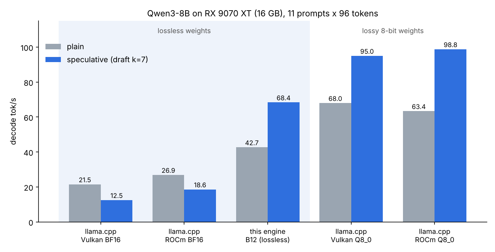

# exact-spec-amd

**Exact speculative decoding and lossless 12-bit weights for Qwen3 on a consumer AMD GPU (RX 9070 XT, 16 GB, Windows).**

- Runs **Qwen3-8B with weights bit-identical to the original bf16 checkpoint**, fully inside 16 GB of VRAM, using a lossless 12-bit weight format (B12).
- **Speculative decoding gives bit-for-bit the same output as plain decoding**, for greedy decoding and for seeded sampling (temperature).
- **68–73 tok/s** for exact Qwen3-8B with speculation. That is 2.5x llama.cpp running the same full-precision weights, and **slower than llama.cpp with lossy 8-bit (Q8_0) weights**.



## Try it (Windows)

**You need:** an AMD RX 9000-series GPU with 16 GB (I tested only the RX 9070 XT), a recent AMD Adrenalin driver, [Python 3.12](https://www.python.org/downloads/), 32 GB of RAM and about 25 GB of free disk.

```
git clone https://github.com/fraggergsrp-alt/exact-spec-amd
cd exact-spec-amd
setup.bat
run.bat "Explain what a hash table is."
```

- `setup.bat` makes a private Python environment in `.venv`, installs AMD's ROCm build of PyTorch and the other packages into it (about 5 GB, nothing system-wide), and checks that the GPU is visible.
- The first `run.bat` downloads Qwen3-8B (about 16 GB). After that the engine starts in about a minute.

More ways to run it:

```
run.bat --chat                                          talk back and forth
run.bat "Write a short poem about the sea." --temp 0.7 --seed 1
run.bat "Count from 1 to 30 in words." --compare        check exactness yourself: runs speculative and plain decoding and compares every token
```

From Python (with `exactspec/` on the path):

```python
from exact8b import ExactEngine
eng = ExactEngine("Qwen/Qwen3-8B", temperature=0.0, seed=42)
print(eng.generate("Explain what a hash table is.", max_new_tokens=200))
print(eng.last_stats)   # tokens, tok/s, rounds
```

This is a research engine, not a product, and every number below was measured on my one PC. If you try it, please open an issue with your GPU, OS and the `RESULT` lines.

## Results (measured, one PC)

**Qwen3-8B**, 11 prompts x 96 tokens, greedy decoding, decode tok/s:

| Setup | Weights | Plain | Speculative | Spec output = plain |
|---|---|---|---|---|
| llama.cpp ROCm BF16, `-ngl 99` (spills past VRAM) | lossless | 26.9 | 18.6 | 10/11 |
| llama.cpp Vulkan BF16 (spills past VRAM) | lossless | 21.5 | 12.5 | 11/11 |
| **this engine, B12** | **lossless** | **42.7** | **68.4** | **11/11** |
| llama.cpp ROCm Q8_0 (fits) | lossy, 8-bit | 63.4 | 98.8 | 7/11 |
| llama.cpp Vulkan Q8_0 (fits) | lossy, 8-bit | 68.0 | 95.0 | 7/11 |

On 50 varied prompts x 512 tokens, exact speculative decoding reached **73.0 tok/s**, with speculative output equal to plain output on **50/50** prompts.

**Exactness** (speculative output == plain output, same engine):

| Model / test | Standard PyTorch kernels | This engine | Speed cost of exactness |
|---|---|---|---|
| Qwen3-1.7B, 50 prompts x 512 tokens, 2 sessions | 35/50 | **50/50** (both sessions) | 2.8–4.3% |
| Qwen3-4B, 50 prompts x 512 tokens, 2 sessions | 50/50 | **50/50** | 3.1–4.3% |
| Qwen3-1.7B, seeded sampling T=0.7 / 1.0 | 38/50, 36/50 | **50/50, 50/50** | 1.7–4.3% |
| Qwen3-8B (B12), 50 prompts x 512 tokens | — | **50/50** | — |

Baselines: llama.cpp ROCm (Lemonade build b1376) and llama.cpp Vulkan (official build b12426), `-c 4096`, draft Qwen3-0.6B Q8_0 with `--spec-draft-n-max 7`, same token ids. All runs used one session of 11 prompts, so the agreement counts are small samples. On this PC, Vulkan crashed until two things were switched off for the benchmark processes: the RenderDoc Vulkan layer (`VK_LOADER_LAYERS_DISABLE=VK_LAYER_RENDERDOC_Capture`) and flash attention (`-fa off`, which costs less than 2% decode speed in llama-bench). Details: [docs/PREREG_CAP1.md](docs/PREREG_CAP1.md), step 5.

**In short:** this is the fastest *lossless* way I measured to run Qwen3-8B on a 16 GB card. The lossy 8-bit format with speculative decoding is about 1.4x faster still, and in my runs llama.cpp's speculative output differed from its own plain output on 4 of 11 prompts.

## How it works

1. **Speculative decoding engine** (batch 1). A Qwen3-0.6B draft with int4 weights proposes 7 tokens, and the target checks them in one pass. It uses custom split-KV attention, fused norms/RoPE/SwiGLU, a multi-row KV write, and draft/verify steps replayed as GPU graphs.
2. **Batch-invariant matrix kernels.** Verifying 8 tokens normally rounds differently from decoding 1 token, so outputs drift. One kernel serves 1–32 rows and sums every output in a fixed per-row order: lane-strided chunks, fp32, no FMA contraction, a fixed shuffle reduction. That makes verify bit-identical to plain decoding (`exactspec/kernel_bi.py`).
3. **Exact seeded sampling.** The token is the argmax of `logit/T + Gumbel(seed, position, token)`, with the noise computed from a hash rather than an RNG state. This gives an exact softmax sample that is a fixed function of each position's logits (`exactspec/sampler.py`).
4. **B12, a lossless 12-bit format for bf16 weights.** Per weight: 8 bits (sign + 7 mantissa bits) plus a 4-bit exponent code within a per-row window of 15 exponents. Weights outside the window are kept in a per-row exception list with their exact bits (0.02% for Qwen3-8B). The format averages 12.0 bits/weight and decodes back to the original bits, and the kernel is batch-invariant (`exactspec/kernel_b12.py`).
5. **Qwen3-8B on 16 GB** (`exactspec/exact8b.py`). The bf16 model is loaded in system RAM, each matrix is packed to B12 on the GPU (about 29 s), and the embedding table stays in system RAM.

## Reproduce my numbers

After `setup.bat`, run:

| Script | What it checks | Time |
|---|---|---|
| `benchmarks\replicate_8b.bat` | Qwen3-8B exact speculative decoding on 11 prompts | ~10 min |
| `benchmarks\replicate_exact_1p7b.bat` | Qwen3-1.7B: exactness and speed, standard kernels vs batch-invariant kernels | ~10 min |

Each prints `RESULT` lines with plain tok/s, speculative tok/s and `spec==plain N/N`. The llama.cpp comparison uses `benchmarks/b6_llamacpp_cap1.py`, with llama.cpp from `benchmarks/get_lemonade_latest.py` and models from `benchmarks/download_gguf.py`.

## What is where

| Folder | Contents |
|---|---|
| `generate.py`, `run.bat`, `setup.bat` | everything you need to use the engine |
| `exactspec/` | the engine: kernels, B12 format, sampler, `exact8b.py` |
| `benchmarks/` | benchmark and replication scripts, the llama.cpp comparison |
| `docs/` | pre-registered experiment notes with all results (including failures), reference result files in `docs/results/` |

## Limitations

- One GPU, one OS (Windows 11), Qwen3 0.6B–8B only, batch size 1.
- Activations are fp16. Exactness means speculative == plain decoding of this engine with the same seed, not equality with other engines.
- In the 1.7B/4B engines, weights are converted bf16 → fp16, which changes 0.04% of weights. Only the 8B B12 path keeps matmul weights bit-identical to the checkpoint.
- Sampling supports temperature only (no top-k/top-p). I tested prompts up to about 1,000 tokens.
- Nobody else has replicated this yet. Lossy 8-bit + speculation is faster.

## Prior work (none of the core ideas is new)

- Speculative decoding: Leviathan et al. 2023; Chen et al. 2023.
- Batch-invariant kernels: Thinking Machines Lab 2025; vLLM/SGLang deterministic modes; LLM-42.
- Drafter-invariant coupling with shared randomness: Daliri, Musco, Suresh 2025.
- Lossless bf16 weight compression: DFloat11 (~11 bits/weight, Huffman-coded exponents; tighter than my 12 bits), ZipServ, ZipNN.

What I add is making these work together on a consumer AMD card, plus the measurements. I wrote down every prediction before running it, including the ones that failed: see [`docs/`](docs).

## Disclosure

I built this with a lot of help from Claude, Anthropic's AI assistant. It wrote most of the code and documentation while I directed the work. I ran every experiment on my own PC.

## License

MIT, see [LICENSE](LICENSE). Qwen3 models are Apache-2.0 and are downloaded from Hugging Face, not included here.
